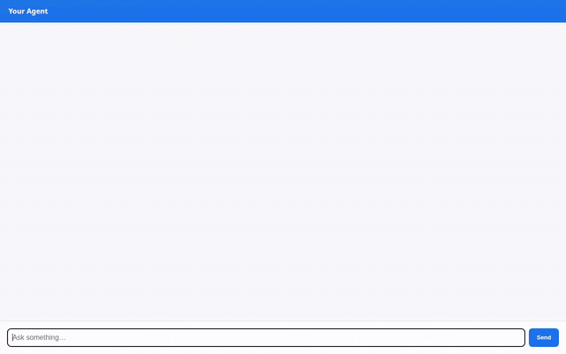

# 🌿 Flora — PlantCare Assistant

An intelligent, agent-first assistant designed to help houseplant owners track collections, calculate custom care routines, monitor ambient microclimates, and generate visual care reference portraits.

Built with the **Google Agent Development Kit (ADK)** and deployed on Google Cloud Agent Platform, Flora provides interactive **A2UI cards**, cross-session memory, and live tool execution.



---

## 🌟 What Flora Does

Flora operates as a personalized botanical companion. Grounded in live database state and real-world conditions, it helps plant parents keep their collections thriving:

- 🗄️ **Houseplant Inventory & Care Log (Firestore):** Tracks active houseplants (species, care requirements, watering interval, last watered date, health status, and room locations). Allows users to list plants, view care guides, log watering events, and register new plants.
- 🌦️ **Live Microclimate & Humidity Lookup (Open-Meteo API):** Fetches real-time ambient weather (temperature, relative humidity, weather conditions) for any city to provide customized care advice based on current air moisture.
- 🧮 **Custom Watering Schedule Calculator:** Calculates custom watering intervals (in days) and estimated water volume (in mL) based on botanical species, pot diameter (inches), pot material (terracotta, plastic, ceramic), and current season.
- 🎨 **Botanical Portrait Generation (Gemini 3.1 Flash Lite Image + Cloud Storage):** Generates photorealistic plant portraits using `gemini-3.1-flash-lite-image` on Vertex AI (global region), saves local artifacts to the Playground, and uploads image bytes directly to a public Cloud Storage bucket for instant inline rendering.
- 🧠 **Cross-Session Long-Term Memory (Vertex AI Memory Bank):** Preloads user preferences and home environment context (room lighting, pet presence, indoor humidity) across conversations via `PreloadMemoryTool` and callback-driven session memory persistence.
- 🪟 **Agent-First UI (A2UI v0.8):** Emits structured A2UI declarative surfaces (Cards, Columns, Rows, and Text components) rendered directly in the custom chat interface.

> **Status of Planned Features:**
> - *Multimodal leaf photo disease diagnosis:* Planned, not yet implemented.

---

## 🏗️ Architecture & Google Cloud Services

| Component | Technology | Implementation Details |
|---|---|---|
| **Core Model & Agent** | Gemini 3.6 Flash (`gemini-3.6-flash`) | ADK `root_agent` with tool orchestration and A2UI schema manager prompt. |
| **Long-Term Memory** | Vertex AI Memory Bank | Managed Agent Engine memory bank wired via `VertexAiMemoryBankService` and `PreloadMemoryTool`. |
| **Structured Storage** | Google Cloud Firestore | Native Firestore client managing collection records in `plants`. |
| **Media Storage** | Google Cloud Storage (GCS) | Dedicated public bucket storing generated botanical images. |
| **Image Generation** | Gemini 3.1 Flash Lite Image | `gemini-3.1-flash-lite-image` on Vertex AI generating high-resolution botanical photography. |
| **Rich Display UI** | A2UI (v0.8 Basic Catalog) | Declarative UI parts emitted via `after_model_callback` for inline interactive card rendering. |
| **Protocol & API** | A2A (Agent-to-Agent) Protocol | GA 1.1.0 Agent Runtime deployment accessible via standard A2A JSON-RPC / HTTP. |
| **Web Frontend** | FastAPI + Vanilla JS | Lightweight proxy communicating with the agent over A2A and rendering A2UI components. |

---

## 📁 Repository Structure

```
.
├── app/
│   ├── agent.py                 # Core ADK agent configuration & A2UI prompt
│   ├── firestore_tools.py       # Firestore integration (list, get, log, add plants)
│   ├── weather_tools.py         # Open-Meteo weather & humidity integration
│   ├── calculator_tools.py      # Botanical watering interval & volume math
│   ├── image_tools.py           # Gemini 3.1 Flash Lite Image & GCS upload tool
│   ├── a2ui_utils.py            # A2UI callback and envelope transformations
│   └── app_utils/               # Memory and session service factories
├── frontend/
│   ├── main.py                  # FastAPI proxy translating browser requests to A2A
│   ├── requirements.txt         # Frontend dependencies (fastapi, a2a-sdk, httpx)
│   └── static/                  # Responsive web chat UI with built-in A2UI renderer
├── seed_firestore.py            # Initializer script for demo plant collection
├── pyproject.toml               # Agent dependencies and metadata
└── agents-cli-manifest.yaml     # Agent deployment manifest
```

---

## 🚀 Running the Project Locally

### Prerequisites

1. **Python 3.11+** and [`uv`](https://docs.astral.sh/uv/) installed.
2. **Google Cloud SDK (`gcloud`)** authenticated with an active project:
   ```bash
   gcloud auth login
   gcloud auth application-default login
   gcloud config set project <YOUR_PROJECT_ID>
   ```

### 1. Seed Firestore Database

Initialize your Firestore database with sample houseplant records (Monty the Monstera, Fiona the Ficus, Penny the Pothos, Ziggy the Snake Plant):

```bash
uv run python seed_firestore.py
```

### 2. Run the Agent Playground

Launch the local ADK Web development server with memory bank support:

```bash
uv run adk web . --port 8000 --reload_agents --memory_service_uri=agentengine://<AGENT_ENGINE_ID>
```

### 3. Run the Custom Frontend

In a separate terminal, launch the custom chat frontend:

```bash
cd frontend
uv venv
source .venv/bin/activate
uv pip install -r requirements.txt

export AGENT_ENGINE_RESOURCE_NAME="projects/<PROJECT_NUMBER>/locations/<REGION>/reasoningEngines/<ENGINE_ID>"
export AGENT_DIRECTORY="app"
export PORT="8080"

python main.py
```

Open a web browser to port `8080` on your machine to interact with Flora.
